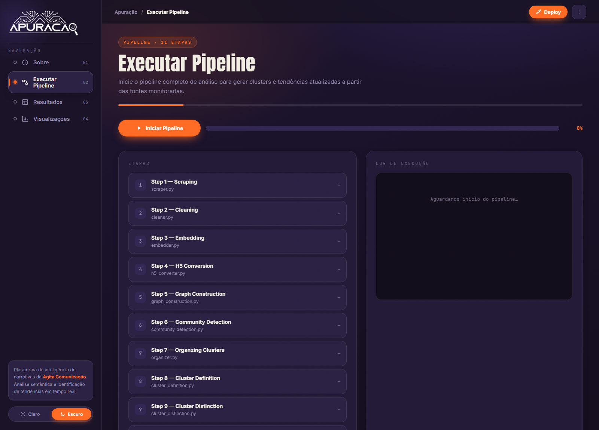
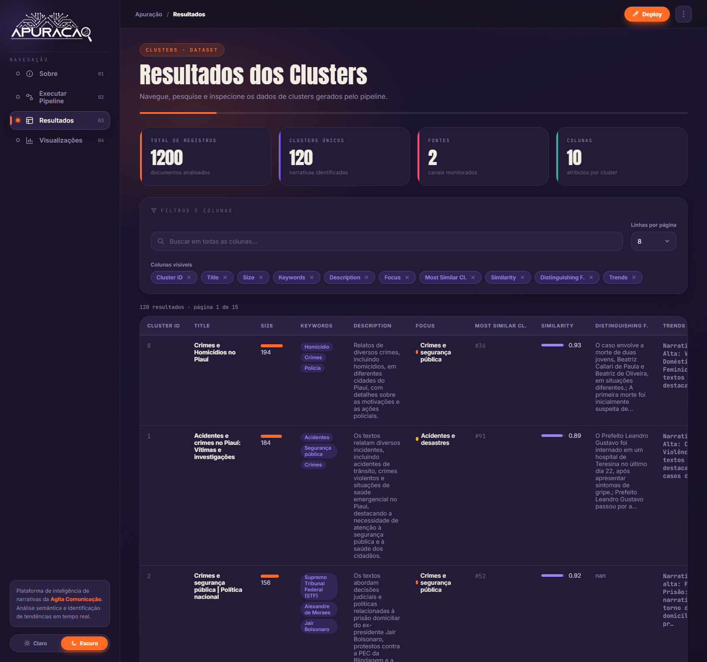
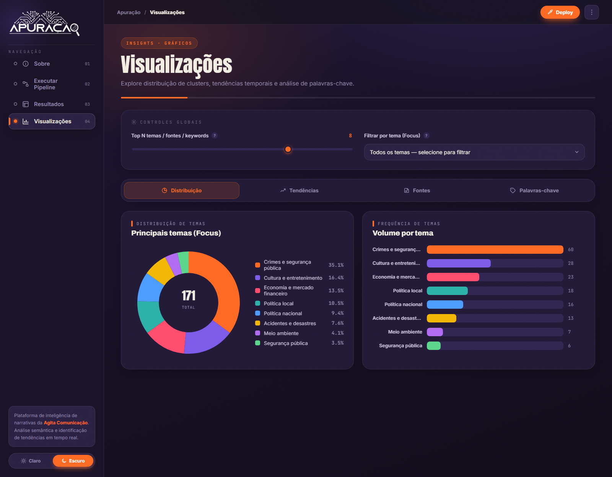

<div align="center">
  

  # Apuração · Agita Comunicação

  **Plataforma de inteligência de narrativas** — coleta, trata e analisa grandes volumes
  de conteúdo digital (notícias e redes sociais), identificando clusters temáticos,
  tendências e dimensões discursivas através de um pipeline de Ciência de Dados + LLM local.
</div>

---

## 📸 Interface

A aplicação é um **dashboard web** com quatro páginas. Todos os dados exibidos são **reais**,
gerados pelo pipeline.

### Sobre
Visão geral da plataforma, com estatísticas reais do dataset (documentos, clusters, fontes).


### Executar Pipeline
Dispara o pipeline completo em background, com as **11 etapas** em sequência, progresso e log ao vivo.


### Resultados
Tabela navegável dos clusters gerados — busca, seleção de colunas e paginação.


### Visualizações
Gráficos interativos (distribuição de temas, tendências temporais, fontes e palavras-chave).


---

## ✨ Funcionalidades

- **Coleta multi-fonte** — crawler de portais de notícias (HTTP/`requests` + `newspaper`) e da API do X/Twitter.
- **Tratamento e normalização** dos textos (deduplicação, limpeza, limite de palavras).
- **Embeddings semânticos** com `sentence-transformers` (modelo `all-MiniLM-L6-v2`).
- **Clusterização** via grafo de similaridade (FAISS k-NN) + detecção de comunidades (Leiden).
- **Análise com LLM local** (Ollama / `qwen2.5:7b`): rotulagem, distinção, tendências e dimensões discursivas.
- **Dashboard web** (React SPA) servido por um servidor Python **sem frameworks externos** (apenas stdlib).
- **Execução do pipeline pela própria interface**, com logs e progresso em tempo real.

---

## 🏗️ Arquitetura

A aplicação web é composta por um **back-end Python (stdlib)** que serve uma **SPA React** estática
e expõe uma pequena API que lê os CSVs do pipeline e dispara os scripts de processamento.

```
                         ┌─────────────────────────────────────────────┐
   navegador  ◄────────► │  server.py  (http.server — stdlib, sem Flask)│
   (React SPA)           │                                             │
                         │  Rotas estáticas:                           │
   Apuracao.html  ◄──────┤    /                → Apuracao.html         │
   app/styles.css ◄──────┤    /app/*           → CSS / data.js         │
   app/data.js    ◄──────┤    /logoofcapudados.png                     │
                         │                                             │
                         │  API JSON:                                  │
   GET  /api/data ◄──────┤    monta os dados reais a partir dos CSVs   │──► pandas ─► data/processed/*.csv
   POST /api/pipeline/start ─► roda os scripts do pipeline (subprocess)│──► scraper.py, cleaner.py, …
   GET  /api/pipeline/status ◄ progresso + logs ao vivo               │
                         └─────────────────────────────────────────────┘
```

- **Front-end:** React 18 + Babel *standalone* (transpilação no navegador) — é HTML/JS estático,
  **não precisa de build**. Os dados dinâmicos vêm de `/api/data`; `app/data.js` serve apenas de
  fallback/conteúdo estático.
- **Back-end:** `server.py` (`http.server.ThreadingHTTPServer`). A montagem dos dados fica em
  `src/utils/web_data.py` (reaproveita a lógica de agregação dos gráficos).
- **Única dependência externa do caminho web:** `pandas`. O resto é stdlib.

---

## 🔬 O Pipeline (11 etapas)

As etapas são definidas em `src/utils/pipeline_runner.py` e executadas em sequência. Cada uma é um
script Python independente na raiz do projeto.

| # | Etapa | Script | O que faz |
|---|-------|--------|-----------|
| 1 | Scraping | `scraper.py` | Coleta URLs e extrai artigos de portais + busca no X/Twitter |
| 2 | Cleaning | `cleaner.py` | Normaliza, deduplica e filtra os textos coletados |
| 3 | Embedding | `embedder.py` | Gera embeddings semânticos (`all-MiniLM-L6-v2`) |
| 4 | H5 Conversion | `h5_converter.py` | Converte os embeddings para shards `.h5` |
| 5 | Graph Construction | `graph_construction.py` | Constrói o grafo k-NN de similaridade (FAISS) |
| 6 | Community Detection | `community_detection.py` | Detecta clusters via algoritmo de Leiden |
| 7 | Organizing Clusters | `organizer.py` | Organiza/separa os artigos por cluster |
| 8 | Cluster Definition | `cluster_definition.py` | LLM: keywords, título, descrição e **Foco** |
| 9 | Cluster Distinction | `cluster_distinction.py` | LLM: características distintivas entre clusters |
| 10 | Trend Extraction | `extract_trends.py` | LLM: narrativas e tendências em alta |
| 11 | Dimension Assessment | `assess_dimensions.py` | LLM: 9 dimensões discursivas por cluster |

> As etapas 8–11 usam um **LLM local via Ollama** (`qwen2.5:7b`). O artefato final é
> `data/processed/clusters_defined_distinguished_trends_assessed.csv`, consumido pelo dashboard.

---

## 🧱 Stack / Tecnologias

| Camada | Tecnologias |
|--------|-------------|
| Web (back-end) | Python stdlib (`http.server`), `pandas` |
| Web (front-end) | React 18, Babel standalone, CSS puro (sem build) |
| Coleta | `requests`, `beautifulsoup4`, `newspaper`, API do X/Twitter |
| Embeddings | `sentence-transformers`, `torch` |
| Clusterização | `faiss`, `python-igraph`, `leidenalg`, `numpy`, `h5py` |
| LLM | `Ollama` (`qwen2.5:7b`), `langchain-ollama`, `langchain-core` |
| Config | arquivos `.toml` (`tomllib`) |

---

## 📋 Pré-requisitos

- **Python 3.11+** (no Windows, use o launcher `py`).
- **Ollama** instalado e rodando, com o modelo baixado:
  ```bash
  ollama pull qwen2.5:7b
  ```
- **Token do X/Twitter** (apenas para a fonte do X), via variável de ambiente:
  ```bash
  # Windows (PowerShell)
  $env:X_BEARER_TOKEN = "seu_bearer_token"
  # macOS/Linux
  export X_BEARER_TOKEN="seu_bearer_token"
  ```
- Dependências Python (principais): `pandas`, `numpy`, `sentence-transformers`, `torch`,
  `faiss-cpu`, `python-igraph`, `leidenalg`, `h5py`, `langchain-ollama`, `langchain-core`,
  `requests`, `beautifulsoup4`, `newspaper3k`, `tqdm`.

> ℹ️ O projeto ainda não possui um `requirements.txt` com versões fixadas — é a melhoria de
> reprodutibilidade recomendada para evitar diferenças entre máquinas.

---

## ▶️ Como rodar

A interface web roda pelo **`server.py`**:

```bash
# Windows
py server.py
#   ou simplesmente: duplo-clique em run_app.bat

# macOS / Linux
python3 server.py
#   ou: ./run_app.command
```

O servidor sobe em **http://127.0.0.1:8501** e abre o navegador automaticamente.

Pela página **Executar Pipeline** você dispara o processamento completo; ao terminar, as páginas
**Resultados** e **Visualizações** passam a exibir os dados gerados. (Enquanto não houver dados,
elas mostram o estado "Execute o pipeline primeiro".)

---

## 🔌 API HTTP

| Método | Rota | Descrição |
|--------|------|-----------|
| `GET` | `/` | Serve a SPA (`Apuracao.html`) |
| `GET` | `/api/data` | Dados reais: stats, clusters, gráficos e etapas do pipeline (JSON) |
| `POST` | `/api/pipeline/start` | Dispara o pipeline em background |
| `GET` | `/api/pipeline/status` | Estado do pipeline: progresso, etapas e logs |
| `GET` | `/app/*`, `/logoofcapudados.png` | Arquivos estáticos |

---

## 🗂️ Estrutura do projeto

```
All-in-crawler/
├─ server.py                 # ⭐ servidor web (entry point atual)
├─ Apuracao.html             # SPA React (front-end)
├─ app/
│  ├─ styles.css             # identidade visual
│  └─ data.js                # conteúdo estático / fallback
├─ run_app.bat / .command    # atalhos para subir o servidor
│
├─ scraper.py … assess_dimensions.py   # os 11 scripts do pipeline
│
├─ src/
│  ├─ utils/
│  │  ├─ web_data.py         # monta o JSON do dashboard a partir dos CSVs
│  │  ├─ pipeline_runner.py  # define e executa as 11 etapas
│  │  ├─ parsing.py          # config (.toml) + parsing de saídas do LLM
│  │  ├─ embedding.py, clustering.py, extraction.py, discovery.py, …
│  │  └─ X/                   # integração com a API do X/Twitter
│  ├─ classes/               # data types
│  └─ visualizations/        # gráficos matplotlib (legado/exportação)
│
├─ config/
│  ├─ directories.toml       # caminhos (data/raw, processed, output, …)
│  ├─ clustering.toml        # parâmetros de grafo e comunidades
│  ├─ ingestion/             # fontes, scraping, cleaning, embedding
│  ├─ analysis/semantic.toml # modelo do LLM, trends, dimensões
│  └─ settings.py            # leitura do X_BEARER_TOKEN
│
├─ data/
│  ├─ raw/                   # coleta bruta + embeddings/shards
│  ├─ processed/             # CSVs tratados (inclui o dataset final)
│  └─ output/                # saídas intermediárias do LLM
│
├─ docs/images/              # screenshots desta documentação
└─ app.py                    # ⚠️ front-end legado (Streamlit) — não é mais o entry point
```

---

## ⚙️ Configuração

Os parâmetros ficam em `config/*.toml` e são carregados por `src/utils/parsing.py`:

- **`directories.toml`** — caminhos de `raw`, `processed`, `checkpoints`, `output`.
- **`ingestion/sources.toml`** — fontes de coleta (portais e buscas no X).
- **`ingestion/scraping.toml`** — `user_agent`, timeouts, tentativas, `sleep_time`, limites.
- **`ingestion/cleaning.toml`** — corte de data e limite de palavras.
- **`ingestion/initial_embedding.toml`** — modelo de embedding e batch.
- **`clustering.toml`** — construção do grafo e parâmetros de comunidade (Leiden).
- **`analysis/semantic.toml`** — modelo do LLM (`model_name`, `temperature`), trends e dimensões.

---

## 📝 Notas

- **`app.py` (Streamlit) é legado.** Foi substituído pelo `server.py` + SPA React e mantido apenas
  como fallback; pode ser removido no futuro junto das dependências que só ele usava
  (`streamlit`, `plotly`, `matplotlib`, `wordcloud`).
- O dashboard relê os CSVs a cada chamada de `/api/data`, então **basta rodar o pipeline e atualizar
  a página** para ver os novos resultados.
